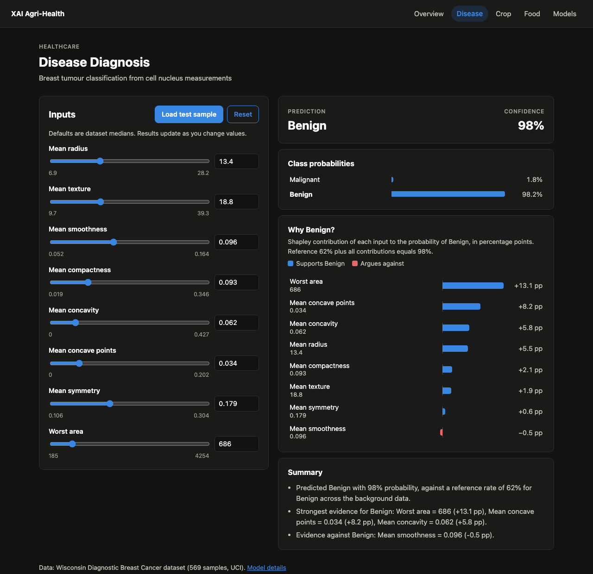
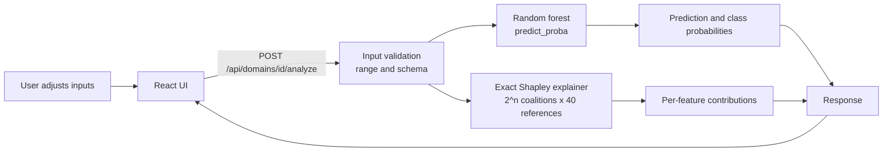
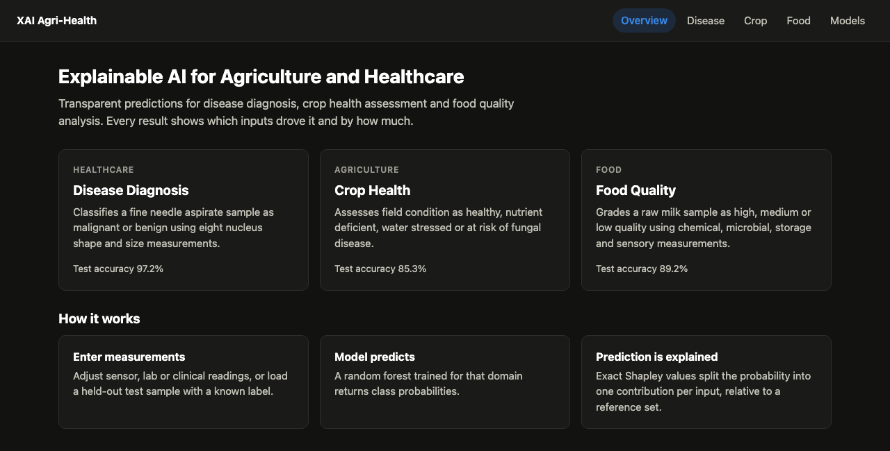
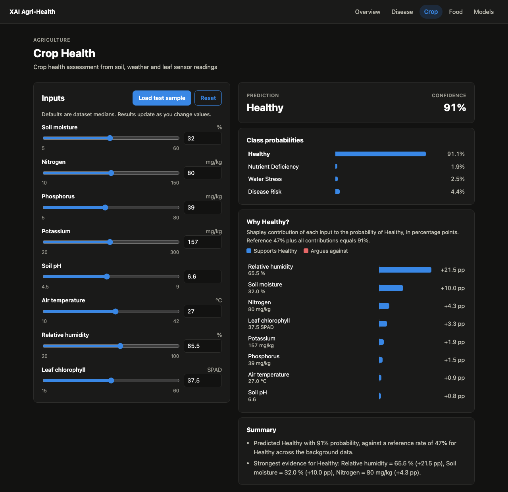
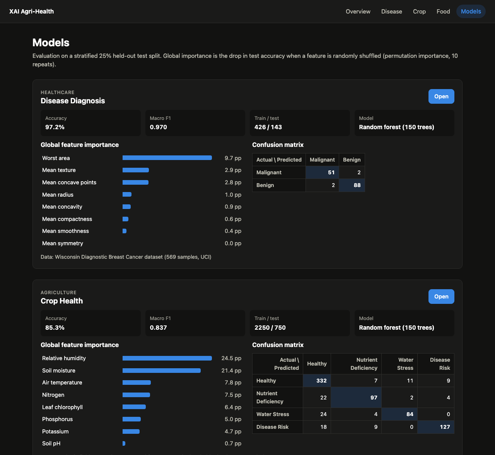

# Explainable AI for Agriculture and Healthcare

Most AI models in medicine and farming give an answer without saying why. This project builds interpretable prediction models for three tasks:

- **Disease diagnosis**: is a breast tumour sample malignant or benign?
- **Crop health**: is a field healthy, short of nutrients, water stressed or at risk of disease?
- **Food quality**: is a raw milk sample high, medium or low grade?

Every prediction comes with an exact breakdown of how much each input measurement raised or lowered the result.



## What it does

| | |
| --- | --- |
| **Predict** | A random forest per domain returns a class and the probability of every class. |
| **Explain locally** | Exact Shapley values split the predicted probability into one signed contribution per input, measured in percentage points. |
| **Explain globally** | Permutation importance ranks which inputs the model depends on across the whole test set. |
| **Summarise** | The top supporting and opposing factors are written out as short sentences, built directly from the numbers. |
| **What-if** | Moving any slider re-runs the prediction and explanation in about 20 ms. |
| **Validate** | You can load a held-out test sample and compare the prediction with the actual label. |

## How it works



### Exact Shapley values

For an input `x` with `n` features, the explainer looks at every subset `S` of features (2ⁿ subsets). For each subset it builds 40 hybrid rows: features in `S` take their values from `x`, and the rest come from 40 reference samples drawn from the training data. The value of the subset, `v(S)`, is the model's average probability over those 40 rows. Each feature's contribution is its weighted average marginal effect over all subsets:

```
φᵢ = Σ  |S|! (n − |S| − 1)! / n!  ·  [ v(S ∪ {i}) − v(S) ]
    S ⊆ N \ {i}
```

This is calculated exactly, not estimated by sampling, and it works with any model. With 8 features that is 256 subsets × 40 references = 10,240 rows, all scored in one vectorised `predict_proba` call. Contributions always add up exactly:

```
reference rate  +  Σ φᵢ  =  predicted probability
```

The test suite checks this for every domain, and the benchmarks below measure the rounding error.

### Training pipeline

1. Load the dataset for the domain.
2. Split 75/25 into train and test, with the same class proportions in both (`random_state=42`).
3. Train `RandomForestClassifier(n_estimators=150, min_samples_leaf=2, class_weight="balanced")`.
4. Evaluate on the test split: accuracy, macro F1 and confusion matrix.
5. Compute permutation importance on the test split (10 repeats).
6. Save the model, reference samples, feature bounds and metrics to `backend/artifacts/<domain>.joblib`.

The server trains any missing model on first start (a few seconds). After that it loads the saved files.

## Datasets

| Domain | Source | Samples | Features | Classes |
| --- | --- | --- | --- | --- |
| Disease Diagnosis | [Wisconsin Diagnostic Breast Cancer](https://archive.ics.uci.edu/dataset/17/breast+cancer+wisconsin+diagnostic) (UCI, bundled with scikit-learn) | 569 | mean radius, texture, smoothness, compactness, concavity, concave points, symmetry, worst area | Malignant (212), Benign (357) |
| Crop Health | Synthetic, generated from agronomic threshold rules (`backend/app/ml/domains/crop.py`) | 3,000 | soil moisture, N, P, K, soil pH, air temperature, relative humidity, leaf chlorophyll (SPAD) | Healthy, Nutrient Deficiency, Water Stress, Disease Risk |
| Food Quality | Synthetic, generated from dairy spoilage and grading rules (`backend/app/ml/domains/food.py`) | 3,000 | pH, storage temperature, time since milking, fat %, bacterial load (log CFU/ml), turbidity, odour score | High, Medium, Low |

The synthetic generators are fixed-seed and encode known relationships. In the milk data, for example, bacterial load grows with storage time × temperature, which then lowers pH and odour score. Label noise is added so the task is not trivial. These datasets are for demonstrating the explanation pipeline. They are not agronomic or food-safety ground truth.

## Benchmarks

All numbers are reproducible with `python -m app.ml.benchmark`. They were measured on an Apple M4 with Python 3.9 and scikit-learn 1.6.1.

### Model performance

| Domain | Model | Test accuracy | Test macro F1 | 5-fold CV accuracy |
| --- | --- | --- | --- | --- |
| Disease Diagnosis | Majority class | 62.9% | 0.386 | 62.7% ± 0.4% |
| Disease Diagnosis | Logistic regression | 92.3% | 0.918 | 95.1% ± 1.6% |
| Disease Diagnosis | **Random forest (deployed)** | **97.2%** | **0.970** | **95.6% ± 1.5%** |
| Crop Health | Majority class | 47.9% | 0.162 | 47.9% ± 0.1% |
| Crop Health | Logistic regression | 87.7% | 0.871 | 87.3% ± 1.6% |
| Crop Health | **Random forest (deployed)** | **85.3%** | **0.837** | **84.3% ± 1.3%** |
| Food Quality | Majority class | 38.0% | 0.184 | 38.0% ± 0.0% |
| Food Quality | Logistic regression | 90.7% | 0.908 | 92.2% ± 0.6% |
| Food Quality | **Random forest (deployed)** | **89.2%** | **0.894** | **90.6% ± 0.6%** |

On the real clinical data, the random forest beats logistic regression by about 5 points of test accuracy. On the two synthetic domains, logistic regression is 1.5–2.5 points ahead, because those labels come from rules that are close to linear. The random forest is used everywhere so all three domains share one model family and one explanation path. Swapping in another model only needs a `predict_proba` function.

Disease confusion matrix on the 143 test samples: 51/53 malignant and 88/90 benign classified correctly.

### Explainer

| Domain | Features | Coalitions | Median latency | p95 latency | Max additivity error |
| --- | --- | --- | --- | --- | --- |
| Disease Diagnosis | 8 | 256 | 15 ms | 18 ms | 1.1e-15 |
| Crop Health | 8 | 256 | 35 ms | 38 ms | 1.0e-15 |
| Food Quality | 7 | 128 | 18 ms | 20 ms | 1.0e-15 |

### Most important features (permutation importance, drop in test accuracy)

| Domain | 1st | 2nd | 3rd |
| --- | --- | --- | --- |
| Disease Diagnosis | Worst area (9.7 pp) | Mean texture (2.9 pp) | Mean concave points (2.8 pp) |
| Crop Health | Relative humidity (24.5 pp) | Soil moisture (21.4 pp) | Air temperature (7.8 pp) |
| Food Quality | Bacterial load (33.6 pp) | pH (7.3 pp) | Odour score (3.3 pp) |

## Screenshots

| Overview | Crop health |
| --- | --- |
|  |  |

| Model evaluation |
| --- |
|  |

## Tech stack

| Layer | Tools |
| --- | --- |
| ML | scikit-learn 1.6 (random forest, permutation importance), NumPy |
| Explainability | Custom exact Shapley explainer (`backend/app/ml/explainer.py`), no SHAP dependency |
| API | FastAPI, Pydantic v2, Uvicorn |
| Frontend | React 18, React Router 6, Vite 6, plain CSS with light and dark themes |
| Testing | pytest, FastAPI TestClient |

## Project structure

```
backend/
  app/
    main.py               FastAPI app, CORS, model loading at startup
    api/
      router.py           /api prefix
      deps.py             domain lookup and store dependencies
      routes/             health and domain endpoints
    ml/
      spec.py             Feature and DomainSpec definitions
      domains/            disease, crop, food: data loaders and metadata
      trainer.py          split, fit, evaluate, permutation importance
      explainer.py        exact Shapley values
      store.py            train-or-load cache in artifacts/
      train.py            retrain all models
      benchmark.py        baselines, cross-validation, explainer timing
    services/analysis.py  validation, prediction, contribution ranking, summary
    schemas.py            request and response models
  tests/test_api.py
frontend/
  src/
    router.jsx            route table
    pages/                Home, Analyze, Models, NotFound
    components/           Layout, FeatureField, ContributionChart, BarList, Status
    api.js                API client
docs/screenshots/
```

## Setup

Requirements: Python 3.9+ and Node.js 18+.

**Backend**

```bash
cd backend
python3 -m venv .venv
source .venv/bin/activate
pip install -r requirements.txt
uvicorn app.main:app --reload --port 8000
```

The first start trains all three models into `backend/artifacts/`.

**Frontend** (in a second terminal)

```bash
cd frontend
npm install
npm run dev
```

Open http://localhost:5173. The Vite dev server forwards `/api` requests to port 8000.

**Other commands**

```bash
cd backend
python -m pytest              # 12 tests: additivity, endpoints, validation
python -m app.ml.train        # retrain and overwrite saved models
python -m app.ml.benchmark    # regenerate the benchmark tables
```

## Routes

| Page | Path |
| --- | --- |
| Overview | `/` |
| Disease diagnosis | `/analyze/disease` |
| Crop health | `/analyze/crop` |
| Food quality | `/analyze/food` |
| Model evaluation | `/models` |

| Method | Endpoint | Returns |
| --- | --- | --- |
| GET | `/api/health` | Status and loaded models |
| GET | `/api/domains` | Domain list with test accuracy |
| GET | `/api/domains/{id}` | Features with bounds and defaults, classes, metrics, confusion matrix, importance |
| GET | `/api/domains/{id}/sample` | A random held-out test sample and its true label |
| POST | `/api/domains/{id}/analyze` | Prediction, probabilities, reference rate, contributions, summary |

Interactive API docs are at http://localhost:8000/docs.

Example:

```bash
curl -X POST localhost:8000/api/domains/crop/analyze \
  -H "Content-Type: application/json" \
  -d '{"values":{"soil_moisture":12,"nitrogen":80,"phosphorus":40,"potassium":160,
       "soil_ph":6.6,"temperature":36,"humidity":35,"chlorophyll":38}}'
```

```json
{
  "prediction": "Water Stress",
  "confidence": 0.96,
  "base_value": 0.09,
  "contributions": [
    { "label": "Soil moisture", "value": 12.0, "contribution": 0.459 },
    { "label": "Air temperature", "value": 36.0, "contribution": 0.165 },
    { "label": "Relative humidity", "value": 35.0, "contribution": 0.163 }
  ],
  "summary": [
    "Predicted Water Stress with 96% probability, against a reference rate of 9% for Water Stress across the background data.",
    "Strongest evidence for Water Stress: Soil moisture = 12.0 % (+45.9 pp), Air temperature = 36.0 °C (+16.5 pp), Relative humidity = 35.0 % (+16.3 pp)."
  ]
}
```

The response above is shortened. Inputs outside the training range, or with missing or unknown features, return `422` with a message naming the problem field.

## Adding a domain

1. Create `backend/app/ml/domains/<name>.py` that defines its `Feature`s, class names, a `load(seed)` function returning `(X, y)`, and a `SPEC`.
2. Register it in `backend/app/ml/domains/__init__.py`.
3. Add a nav link in `frontend/src/components/Layout.jsx`.

The form, charts, evaluation page and API work automatically from the spec.

## Limitations

- Crop and food results come from synthetic data and show that the method works, not how it performs in the field.
- Exact Shapley cost grows as 2ⁿ. Beyond about 15 features, a sampling-based or tree-specific estimator is needed.
- Contributions are measured against the reference set. When features are strongly correlated, hybrid rows can combine values that never occur together.
- Only tabular inputs are supported.

## Roadmap

- Replace the synthetic data with field datasets (soil and crop sensor logs, milk quality lab data)
- Image models for leaf disease and radiology, with Grad-CAM heatmaps
- Counterfactuals: the smallest change to the inputs that flips the prediction
- Exportable per-sample explanation reports
